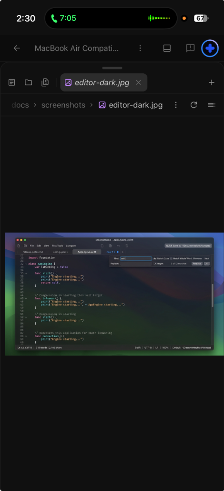
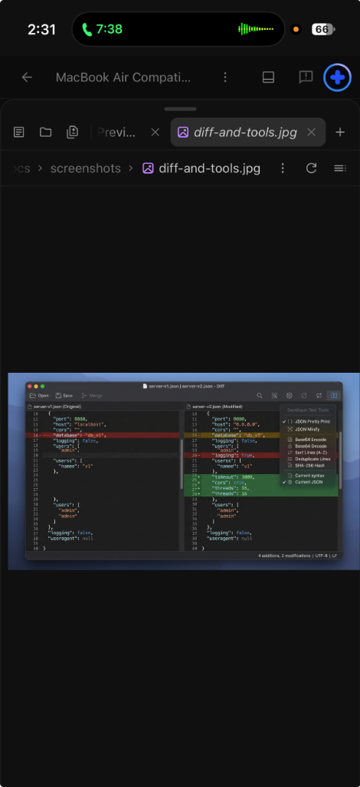
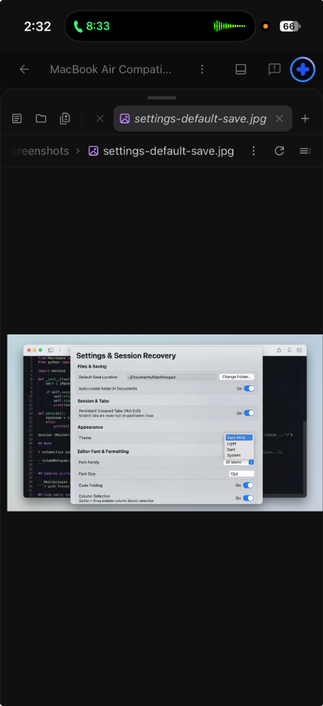

# MacNotepad (`Notebook++` for macOS)

-blue)


**MacNotepad** is a 100% native macOS text and source code editor that merges the **sleek, modern aesthetic of the new Windows 11 Notepad** with the **developer power tools of Notepad++**.

Designed for instant startup and minimal memory usage on Apple Silicon MacBook Air and MacBook Pro machines, it combines a clean translucent tab interface with persistent unsaved scratch tabs, a default save folder under `~/Documents/MacNotepad`, regex Find & Replace, side-by-side Diff Comparison, and built-in developer text utilities.

---

## Screenshots

### 1. Modern Windows 11 Notepad UI + Notepad++ Syntax & Floating Regex Find/Replace


### 2. Side-by-Side Split Diff Comparison & Built-in Developer Text Tools


### 3. Settings, Session Recovery (Hot Exit), & `~/Documents/MacNotepad` Default Save Folder


---

## Key Features

### Modern "New Windows Notepad" Experience
- **Title-Bar Integrated Rounded Tabs:** Clean pill-style tabs with subtle unsaved indicator dots (`•`), instant `+` scratch tab creation, and drag-free organization.
- **Persistent Unsaved Tabs ("Hot Exit" Session Recovery):** Close the app at any time without saving dialogs—all open files and untitled scratch tabs (`new 1`, `new 2`…) are automatically snapshotted to `~/Library/Application Support/MacNotepad/` and restored at the exact cursor position on relaunch.
- **Default Save Location Under `~/Documents/MacNotepad`:** Pre-configured out of the box to auto-create and save into `~/Documents/MacNotepad` via one-click **Quick Save** or `Cmd + S` (customizable in Settings).
- **Floating Find & Replace Pill Bar:** Drops down smoothly at the top-right of the editor with inline toggles for **Regex (`.*`)**, **Match Case (`Aa`)**, **Whole Word**, capture-group replacements (`$1`, `$2`), and **Find in Files**.
- **Modern Status Bar:** Live **Line & Column (`Ln X, Col Y`)**, **Word Count**, **Character Count**, **Selection Count**, **Syntax Language**, **Zoom %**, **Line Endings (`LF`/`CRLF`)**, and **Encoding (`UTF-8`)**.

### Notepad++ Power Under the Hood
- **Syntax Highlighting & Code Folding:** Native `AppKit` `NSTextView` engine with syntax highlighting and collapsible code-folding blocks for Swift, Python, JavaScript/TypeScript, JSON, HTML/XML, Markdown, SQL, CSS, Bash, and Plain Text.
- **Column / Rectangular Block Selection:** Hold `Option` and drag with the mouse in the editor to select and edit rectangular columns of text.
- **Side-by-Side Split & Diff View:** Compare any two open tabs side-by-side with automatic LCS line diffing (`+added`, `~modified`, `-removed` highlights).
- **Built-in Developer Text Tools:**
  - **JSON:** Pretty Print & Minify (sorted keys, validated)
  - **XML / HTML:** Pretty Print with automatic tag indentation
  - **Encoding:** Base64 Encode/Decode, URL Encode/Decode
  - **Line Operations:** Sort Lines (A→Z, Z→A, by Length), Deduplicate Lines, Remove Empty Lines, Trim Trailing Whitespace
  - **Case & Hashing:** `UPPERCASE`, `lowercase`, `Title Case`, and `SHA-256` Hash generation (`CryptoKit`)

---

## Project Architecture

```text
MacNotepad/
├── Package.swift                                  # Swift 5.9+ native macOS package manifest
├── .github/workflows/macos-build.yml              # Automated GitHub Actions macOS .app & .dmg builder
├── scripts/package-app.sh                         # Bundles universal binary into MacNotepad.app & .dmg
├── docs/screenshots/                              # High-resolution UI screenshots
├── Sources/MacNotepad/
│   ├── MacNotepadApp.swift                        # @main SwiftUI App entry point
│   ├── Models/
│   │   └── DocumentTab.swift                      # Tab state, language detection, word/char counters
│   ├── Services/
│   │   ├── SessionManager.swift                   # Hot Exit session persistence & ~/Documents/MacNotepad save manager
│   │   ├── SyntaxHighlighter.swift                # Language keywords & code folding block detector
│   │   ├── SearchEngine.swift                     # Regex / Case / Whole-Word Find & Replace + Find in Files
│   │   ├── DiffEngine.swift                       # Side-by-side LCS line comparison engine
│   │   └── TextToolsService.swift                 # JSON/XML formatters, Base64/URL, line sorting, SHA-256
│   └── Views/
│       ├── MainWorkspaceView.swift                # Unified tab bar, command bar, floating Find, Diff & Settings UI
│       └── CodeEditorView.swift                   # AppKit NSTextView representable bridge
└── Tests/MacNotepadTests/
    └── MacNotepadTests.swift                      # Unit tests for save manager, regex, diff, and text tools
```

---

## Getting It on Your MacBook Air

### Option 1: Download the Ready-to-Run `.dmg` / `.app` from GitHub Actions (No Xcode Required)
1. Open the **Actions** tab in this GitHub repository and select the latest **Build macOS App & DMG** workflow run.
2. Download the **`MacNotepad-macOS-Universal-DMG`** artifact.
3. Open `MacNotepad.dmg` and drag **`MacNotepad.app`** to your `/Applications` folder.

### Option 2: Build & Run Locally on Your MacBook Air (Xcode or Terminal)
```bash
# 1. Clone the repository
git clone https://github.com/CodeBlueMD/MacNotepad.git
cd MacNotepad

# 2. Open directly in Xcode (press Cmd+R to run)
open Package.swift

# OR package MacNotepad.app and MacNotepad.dmg from Terminal:
chmod +x scripts/package-app.sh
./scripts/package-app.sh
open build/MacNotepad.app
```

---

## Keyboard Shortcuts

| Action | Shortcut |
| :--- | :--- |
| New Scratch Tab | `Cmd + N` |
| Open File… | `Cmd + O` |
| Save to `~/Documents/MacNotepad` | `Cmd + S` |
| Find & Replace Bar | `Cmd + F` / `Cmd + Option + F` |
| Column / Block Selection | `Option + Mouse Drag` |
| Preferences & Default Save Folder | `Cmd + ,` |

---

## License
Released under the [MIT License](LICENSE).
