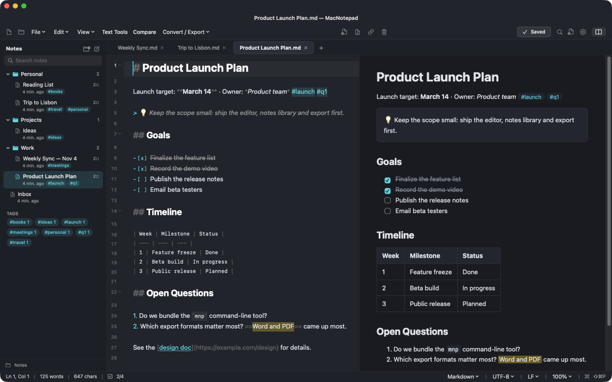
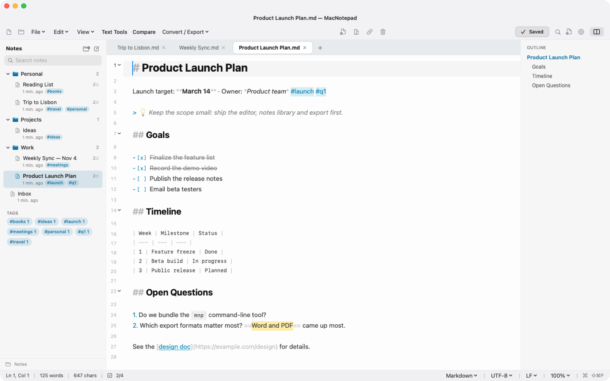
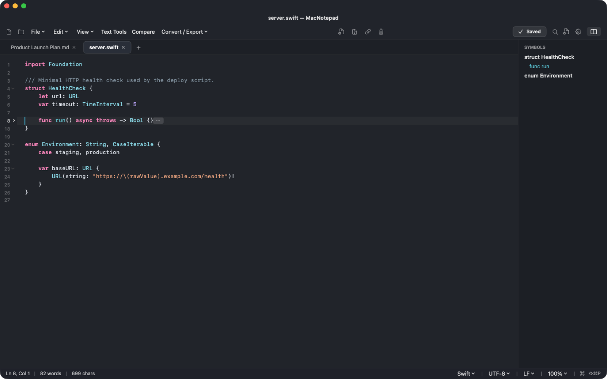
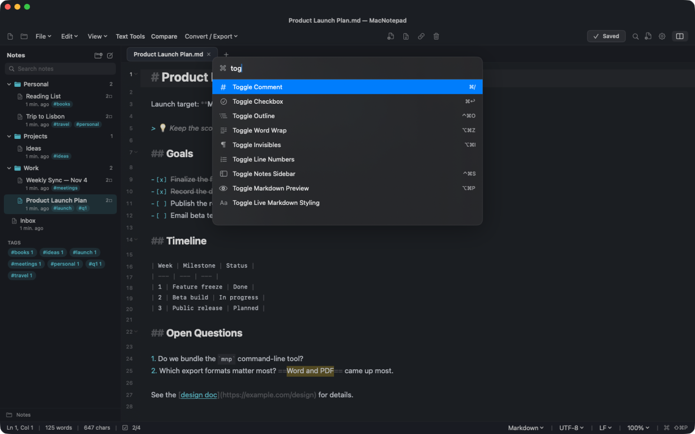
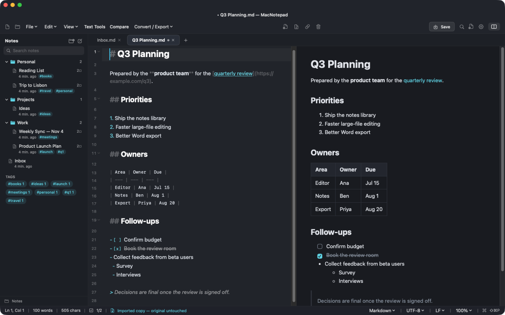

<p align="center">
  
</p>

<h1 align="center">MacNotepad</h1>

<p align="center">
  A native macOS notes app and text editor: Notion-style Markdown notes, Notepad++ editing power, and the clean feel of the new Windows Notepad. It opens Word documents without ever changing them.
</p>

<p align="center">
  
</p>

## Highlights

- **Notes like Notion.** Headings, to-dos, tables, callouts and highlights are styled as you type. A `/` menu inserts blocks, folders act as notebooks, and `#tags` are collected automatically.
- **Editing like Notepad++.** Multiple cursors, line tools, code folding, a symbol list, regex find and replace, file compare, and encoding and line-ending conversion.
- **A real Mac app.** Native menu bar, Finder "Open With", Open Recent, a menu-bar quick note, a global hotkey, the `mnp` command, `macnotepad://` links, Apple Intelligence Writing Tools, and Light/Dark/System themes.
- **Safe with Word files.** A `.docx`, `.rtf`, `.odt` or `.pdf` opens as an editable Markdown copy, and the original file is never written to. Notes export back to Word with real heading styles, lists and tables.
- **Never lose text.** Unsaved tabs survive quitting and restarting, and files changed by another app reload automatically.

## Notes

<p align="center">
  
</p>

- **Live Markdown.** Notes use a readable proportional font with sized headings, real **bold** and *italic*, ~~strikethrough~~, ==highlights==, `inline code`, links and `#tags`. The Markdown symbols stay visible but dimmed, so the file is always plain Markdown.
- **To-dos.** Click a `[ ]` to tick it, or press <kbd>⌘</kbd><kbd>↩</kbd>. The status bar and the sidebar show how many are done or still open.
- **Smart Enter.** Lists, numbered lists, to-dos and quotes continue on the next line. Pressing Enter on an empty item ends the list, and <kbd>Tab</kbd> / <kbd>⇧</kbd><kbd>Tab</kbd> indent or outdent it.
- **The `/` menu.** Type `/` on an empty line to insert Text, Heading 1–3, To-do, Bulleted or Numbered list, Quote, Callout, Code block, Table, Divider or Today's date.
- **Notes library** (<kbd>⌃</kbd><kbd>⌘</kbd><kbd>S</kbd>). It's off by default, so MacNotepad opens like Notepad, with just a blank page:
  - Every note in your notes folder (default `~/Documents/MacNotepad`), with folders as notebooks.
  - Search across titles, tags and note text.
  - A tag cloud to filter by tag.
  - Right-click to rename, reveal in Finder, or move to the Trash.
  - A new note is named after its first heading the first time you save it.
- **Outline.** Appears on its own for Markdown notes that have headings, and lists them so you can click to jump. For code it lists functions and types; <kbd>⌃</kbd><kbd>⌘</kbd><kbd>O</kbd> shows or hides it for any file.
- **Preview** (<kbd>⌥</kbd><kbd>⌘</kbd><kbd>P</kbd>). Shows the rendered note side by side and keeps your scroll position while you type.
- **Quick capture.** Click the menu-bar icon to jot a thought into `Inbox.md`, or press <kbd>⌃</kbd><kbd>⌥</kbd><kbd>N</kbd> in any app to open a new quick note.

## Editing

<p align="center">
  
</p>

- **Multiple cursors.**
  - <kbd>⌘</kbd><kbd>D</kbd> selects the next occurrence; <kbd>⇧</kbd><kbd>⌘</kbd><kbd>L</kbd> selects all of them.
  - <kbd>⇧</kbd><kbd>⌘</kbd><kbd>I</kbd> puts a cursor at the end of every selected line.
  - <kbd>⌥</kbd><kbd>⌘</kbd>-click adds a cursor; <kbd>⌥</kbd>-drag makes a column (block) selection.
  - Typing and deleting apply at every cursor.
- **Line tools.** Duplicate (<kbd>⇧</kbd><kbd>⌘</kbd><kbd>D</kbd>), delete (<kbd>⇧</kbd><kbd>⌘</kbd><kbd>K</kbd>), move up or down (<kbd>⌥</kbd><kbd>↑</kbd> / <kbd>⌥</kbd><kbd>↓</kbd>), toggle comment (<kbd>⌘</kbd><kbd>/</kbd>), indent and outdent (<kbd>⌘</kbd><kbd>]</kbd> / <kbd>⌘</kbd><kbd>[</kbd>), and go to line (<kbd>⌘</kbd><kbd>L</kbd>).
- **Code folding.** Fold `{ }` blocks, Python indented blocks and Markdown sections from the gutter, or use <kbd>⌥</kbd><kbd>⌘</kbd><kbd>←</kbd> / <kbd>→</kbd> (add <kbd>⇧</kbd> for Fold All / Unfold All). Folding never changes the text.
- **Helpers while you type.**
  - Brackets and quotes close themselves.
  - New lines are indented to match, with an extra level after an opening `{` or `:`.
  - The matching bracket and other copies of the selected word are highlighted.
  - <kbd>⌥</kbd><kbd>⌘</kbd><kbd>I</kbd> shows spaces, tabs and line breaks.
- **Syntax highlighting.** Swift, Python, JavaScript/TypeScript, JSON, HTML/XML, SQL, CSS, Shell and Markdown. Only the lines you change are recolored, so typing stays instant.
- **Find & Replace** (<kbd>⌘</kbd><kbd>F</kbd>). Regex, match case, whole word, and `$1` replacements. **Find in Notes Folder** is <kbd>⇧</kbd><kbd>⌘</kbd><kbd>F</kbd>.
- **Compare** (<kbd>⌥</kbd><kbd>⌘</kbd><kbd>D</kbd>). Shows two tabs side by side with added, changed and removed lines, and can merge one into the other.
- **Text tools.** JSON pretty-print and minify, XML formatting, Base64 and URL encode/decode, sort, remove duplicate lines, remove empty lines, trim whitespace, change case, and SHA-256.
- **Encodings and line endings.**
  - Detects UTF-8 (with or without BOM), UTF-16 LE/BE, Windows-1252, Shift JIS and more.
  - Reopen a file with a different encoding, or convert it to one.
  - Keeps each file's Windows (CRLF) or Mac/Unix (LF) line endings.
- **Big files.** Files over about 2 MB open in a fast plain mode with no colouring, so editing stays smooth.

### Command palette

<p align="center">
  
</p>

<kbd>⇧</kbd><kbd>⌘</kbd><kbd>P</kbd> lists every command, text tool, language, theme, export format, recent file and open tab. Type a few letters to filter it.

## Word, PDF and other documents

<p align="center">
  
</p>

- **Opening.** A `.docx` opens as a Markdown copy that keeps its headings (from Word's heading styles), **bold**/*italic*/~~strikethrough~~, bulleted, numbered and nested lists, tables and links. `.rtf`, `.odt` and `.doc` files go through macOS's converter, and PDFs open as their text.
- **The original is never written to.** <kbd>⌘</kbd><kbd>S</kbd> saves the copy as a new `.md` note, and MacNotepad refuses to write plain text over any `.docx`, `.doc`, `.rtf`, `.odt`, `.pdf` or `.pages` file. The test suite checks the original file's SHA-256 hash before and after saving.
- **Exporting.** Notes export to Word (`.docx`) with real Heading 1–6 styles, numbered lists and tables, so Word's navigation pane works. You can also export to PDF, RTF, HTML (styled like the preview), `.doc`, Markdown or plain text, from **File ▸ Export As** or the toolbar.

## Mac integration

- A full menu bar (File, Edit, Line, Format, View, Tabs, Tools) with standard shortcuts.
- **Finder "Open With"** for text, code, Markdown, JSON, CSV, logs and more. Word, RTF and PDF files open as safe imported copies.
- **Open Recent**, a **Dock menu** (New Note, New Quick Note), and drag-and-drop onto the window.
- When another app changes an open file, a clean tab reloads silently. If you have unsaved edits, a banner lets you choose **Reload** or **Keep My Version**.
- **Apple Intelligence Writing Tools** (rewrite, proofread, summarize) on macOS 15 and later on supported Macs.
- **Light, Dark (Mica) or System** theme.

## Automation

**`mnp` command.** Install it from **Tools ▸ Install Command Line Tool**. It asks for your password once to put it in `/usr/local/bin`, otherwise it goes in `~/.local/bin`.

```bash
mnp notes.md
```

```bash
mnp Sources/App.swift:42
```

```bash
git log | mnp
```

**`macnotepad://` links** work from Shortcuts ("Open URLs"), Raycast, Alfred or scripts:

| Link | Does |
| --- | --- |
| `macnotepad://new?title=Idea.md&text=Hello` | New note with text |
| `macnotepad://append?text=Buy%20milk` | Adds a timestamped line to `Inbox.md` |
| `macnotepad://open?path=/path/to/file&line=12` | Opens a file at a line |
| `macnotepad://quicknote` | New quick note |

## Keyboard shortcuts

| | |
| --- | --- |
| New tab / New note / Quick note | <kbd>⌘</kbd><kbd>N</kbd> · <kbd>⌥</kbd><kbd>⌘</kbd><kbd>N</kbd> · <kbd>⌃</kbd><kbd>⌥</kbd><kbd>N</kbd> (any app) |
| Save / Save As / Save All | <kbd>⌘</kbd><kbd>S</kbd> · <kbd>⇧</kbd><kbd>⌘</kbd><kbd>S</kbd> · <kbd>⌥</kbd><kbd>⌘</kbd><kbd>S</kbd> |
| Command palette | <kbd>⇧</kbd><kbd>⌘</kbd><kbd>P</kbd> |
| Bold / Italic / Strikethrough / Highlight / Code / Link | <kbd>⌘</kbd><kbd>B</kbd> · <kbd>⌘</kbd><kbd>I</kbd> · <kbd>⇧</kbd><kbd>⌘</kbd><kbd>X</kbd> · <kbd>⇧</kbd><kbd>⌘</kbd><kbd>H</kbd> · <kbd>⌘</kbd><kbd>E</kbd> · <kbd>⌘</kbd><kbd>K</kbd> |
| Text, Heading 1–3, To-do, Bullets, Numbers, Quote | <kbd>⌥</kbd><kbd>⌘</kbd><kbd>0</kbd> – <kbd>7</kbd> |
| Insert block / Today's date | <kbd>⌥</kbd><kbd>⌘</kbd><kbd>/</kbd> (or type `/`) · <kbd>⇧</kbd><kbd>⌘</kbd><kbd>;</kbd> |
| Notes library / Outline / Preview | <kbd>⌃</kbd><kbd>⌘</kbd><kbd>S</kbd> · <kbd>⌃</kbd><kbd>⌘</kbd><kbd>O</kbd> · <kbd>⌥</kbd><kbd>⌘</kbd><kbd>P</kbd> |
| Next / previous tab, tab 1–9 | <kbd>⇧</kbd><kbd>⌘</kbd><kbd>]</kbd> · <kbd>⇧</kbd><kbd>⌘</kbd><kbd>[</kbd> · <kbd>⌘</kbd><kbd>1</kbd>–<kbd>9</kbd> |
| Zoom | <kbd>⌘</kbd><kbd>=</kbd> · <kbd>⌘</kbd><kbd>-</kbd> · <kbd>⌘</kbd><kbd>0</kbd> |

## Install

1. Download `MacNotepad-macOS-Universal-DMG` from the latest [GitHub Actions run](../../actions), or build it yourself (below).
2. Open `MacNotepad.dmg` and drag **MacNotepad.app** to Applications.
3. The app is ad-hoc signed, so the first time, right-click it and choose **Open**.

Needs macOS 13 Ventura or later, on Apple silicon or Intel.

## Build from source

```bash
swift test
```

```bash
./scripts/package-app.sh
```

The second command builds `build/MacNotepad.app` (with its icon, file types and URL scheme) and `build/MacNotepad.dmg`.

**Demo library.** `scripts/make-demo-notes.sh <dir>` creates sample notes. Run the app against them without touching your own notes:

```bash
MACNOTEPAD_DATA_DIR=<dir> build/MacNotepad.app/Contents/MacOS/MacNotepad
```

The README screenshots were captured this way.

## Where your data lives

| What | Where |
| --- | --- |
| Notes and saved files | `~/Documents/MacNotepad` (change it in Settings) |
| Unsaved tabs and settings | `~/Library/Application Support/MacNotepad/` |

Notes are ordinary `.md` / `.txt` files, so you can sync them with iCloud Drive or Dropbox, or edit them in any other app.

## Project layout

```text
Sources/MacNotepad/
├── MacNotepadApp.swift          App, menu bar commands, Finder / URL handling, Dock menu
├── App/                         Global hotkey, mnp command-line installer
├── Models/                      DocumentTab, WorkspaceStore (app state), NotesLibrary
├── Services/                    FileService (encodings, safe saving), DocxImporter / DocxExporter,
│                                MarkdownService, FoldingService, SyntaxHighlighter, SearchEngine,
│                                DiffEngine, TextToolsService, SessionManager
└── Views/                       MainWorkspaceView, EditorTextView (editing commands), CodeEditorView,
                                 MarkdownStyler, NotesSidebarView, preview & palette, quick capture
Tests/MacNotepadTests/           Word safety and round trips, encodings, editor commands, Markdown, notes
```

## Not included yet

- Tabs can't be dragged out into a separate window; MacNotepad uses a single main window.
- Shortcuts integration works through `macnotepad://` links, not native App Intents actions.
- PDFs import as text only; images inside Word files aren't brought over.

## License

MIT. See [LICENSE](LICENSE).
